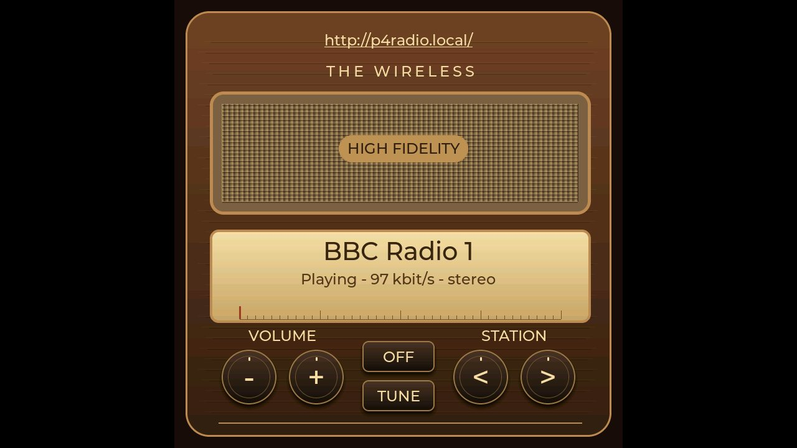
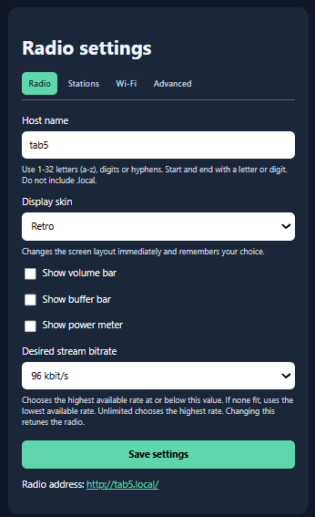
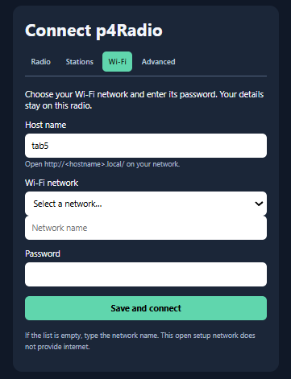

# p4Radio Manual

## Setup

### Connecting the p4radio to your WiFi

> [!TIP]
> Have your WiFi name (SSID) and password ready.

If the WiFi is not configured or the p4radio is now out of range of the
previously configured wifi. It will display a QR code on the screen.

* Scan the QR code with your phone to attach your phone directly to the p4radio.

A new QR code will be displayed.

* Scan the second QR code with your phone to go to the p4radio setup page.

The p4radio will scan for available WiFi networks.

* Select your WiFi network from the list and enter the password.

The p4radio will connect to your WiFi.

## Basic controls

* Change to previous or next station in p4Radio's list of stations.
* Adjust the volume up or down.
* OFF will blank the screen and stop the stream.
* Tapping the screen will turn the screen back on and resume the stream.

> [!WARNING]
> At time of writing the p4radio is not completely off. If running from a battery it will continue to draw power.

### Device specific advice for battery powered devices

|Device|Advice|
|--------|--------|
|M5 Stack TAB5|Remove the battery when not in use|
|ESP32-S3-Touch-LCD-1.85C|Use the battery switch to turn off the device when not in use|

## Skins

### Retro skin (TAB5)

### Square skin (TAB5)

## Web page settings

